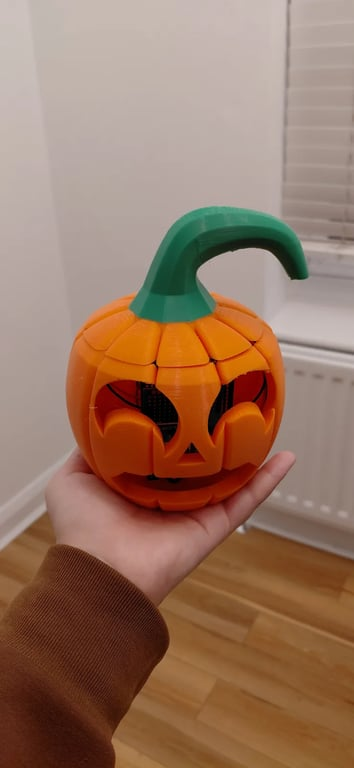
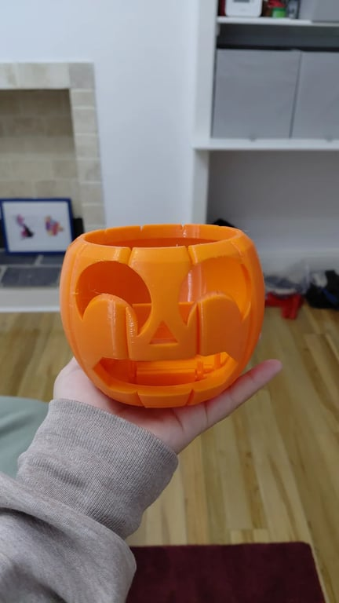
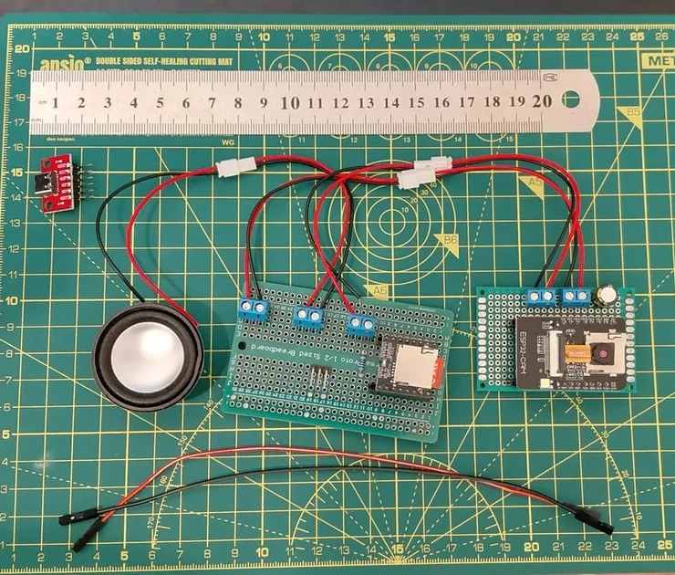
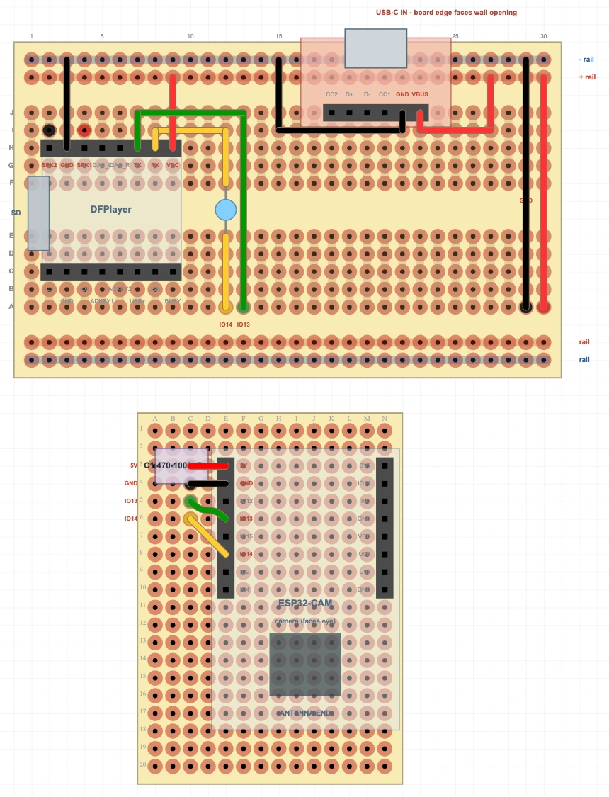

# Pumpkin Boo

> A 3D-printed Halloween pumpkin that spots people with its camera and shouts BOO! at them.

[][yt]
[][tt]
[][ig]

<p>
  
  
  
</p>

## What it does

An ESP32-CAM looks out through the pumpkin's mouth and runs Google's person detection model on the board itself. When someone walks past, a DFPlayer Mini plays a BOO! through a small speaker.

## Parts

| Qty | Part | Price |
| --- | --- | --- |
| 1 | ESP32-CAM with ESP32-CAM-MB programmer | £7.90 |
| 1 | DFPlayer Mini | £0.90 |
| 1 | microSD card, 16 GB | £3.04 |
| 1 | Speaker, 40 mm 4 ohm 3 W | £0.66 |
| 1 | USB-C female breakout | £0.22 |
| 1 | Half-size solderable breadboard PCB | £2.63 |
| 1 | Perfboard, 60 x 40 mm | £0.43 |
| 3 | JST PH2.0 2-pin wire pairs | - |
| 2 | Jumper wires, USB-C breakout to the main board | - |
| 5 | Screw terminals, 2-pin | - |
| 1 | 1 kohm resistor | - |
| 1 | 470 µF capacitor | - |
| 153 g | PETG filament, orange and green | £5.36 |

**Total: about £22**

## Wiring

| Part | Pin | Connects to |
| --- | --- | --- |
| DFPlayer Mini | RX | ESP32 GPIO14 through the 1 kohm resistor |
| | TX | ESP32 GPIO13 |
| | VCC / GND | 5 V / GND |
| | SPK1 / SPK2 | Speaker |
| ESP32-CAM | 5V / GND | 5 V / GND |
| USB-C breakout | VBUS / GND | 5 V / GND |



The layout file is [`layout/pumpkin-boo.diy`](layout/pumpkin-boo.diy), which opens in [DIYLC](https://bancika.github.io/diy-layout-creator/).

## Enclosure

Modelled in Onshape by following [LearnItDoItMakeIt's pumpkin video][credit-cad], then reshaped to fit the electronics. It prints in PETG as a bowl and a lid, with a filament change to green for the stem.

| Part | File | Weight | Print time |
| --- | --- | --- | --- |
| Bowl (holds the electronics) | [`print/pumpkin-bowl.stl`](print/pumpkin-bowl.stl) | 115 g | About 3 h 45 min |
| Lid | [`print/pumpkin-lid.stl`](print/pumpkin-lid.stl) | 38 g | About 1 h 30 min |

[`print/pumpkin-boo.3mf`](print/pumpkin-boo.3mf) is a ready-to-print Bambu Studio project with the bowl on plate 1 and the lid on plate 2, supports painted and the green colour change set.

Also on [Printables][printables] and [MakerWorld][makerworld]. The [Onshape document][onshape] includes the "Pumpkin Boo internals" custom feature that builds the internal supports, which were planned with AI assistance.

### Print settings

Printed in PETG with a 0.4 mm nozzle on a textured PEI plate. The bowl was printed on a Bambu A1 Mini and the lid on a P1S.

- **Layers:** 0.28 mm, 2 walls, grid infill (10% for the bowl, 15% for the lid).
- **Temperature:** 255 °C nozzle, 70 °C bed.
- **Speed:** max volumetric speed raised from the generic PETG default to 15 mm³/s for the bowl. At 0.20 mm with the default speed the bowl took 5 h 44 min.
- **Orientation:** bowl on its flat base; lid on its flat cut face with the stem pointing up.
- **Supports:** tree supports painted only where needed: the top edge of the mouth (about 60 mm over air) and the tops of the eyes on the bowl, and under the stem's curl on the lid. Nothing inside the bowl needs support.
- **Two-colour stem:** one filament change to green at 10.84 mm (layer 39) on the lid. Print the bowl and the lid on separate plates, or the printer swaps colour on every shared layer.

## Firmware

- Copy `main/secrets.example.h` to `main/secrets.h` and add your Wi-Fi and passwords.
- First upload: put the ESP32-CAM on the ESP32-CAM-MB, choose **AI Thinker ESP32-CAM** and **Tools > Partition Scheme > Minimal SPIFFS (1.9MB APP with OTA)**, then upload `main/main.ino`.
- After that, upload over Wi-Fi: pick `boo-pumpkin` under **Tools > Port**.
- The boo sounds are in `mp3/`. Copy the folder to the DFPlayer's microSD card and set `BOO_VOICE` in `main.ino`.

## Status page

Open `http://boo-pumpkin.local/` (or the IP address printed in Serial Monitor at 115200 baud) on the same network, and log in as `boo` with your `PAGE_PASSWORD`.

| Page | What it does |
| --- | --- |
| `/` | Live view: what the model sees, the camera frame, person score, sound settings and recent events, plus buttons |
| `/capture` | The full camera frame as a JPEG |
| `/input` | The 96x96 picture the model scores |
| `/boo` | Plays the boo, even in quiet mode |
| `/volume?level=0-30` | Sets the volume |
| `/quiet?on=1` or `0` | Quiet mode: detections are counted and logged but make no sound |
| `/state` | One line of `key=value` pairs for scripts |

## Phone and laptop tool

`tools/capture.sh` controls the pumpkin from a terminal, including Termux on Android, and saves camera frames into [`frames/`](frames/) for training a better model.

```sh
capture find                     # find the pumpkin on this network and remember it
capture watch                    # live person score; prints BOO! (and vibrates in Termux) when it triggers
capture quiet on                 # silent detections
capture vol 20                   # volume 0-30
capture list                     # saved frame types and counts
capture hallway-empty            # save frames into training/hallway-empty/ until Ctrl+C
```

**Termux setup (Android):**

1. `pkg install curl net-tools` and `termux-setup-storage`, then allow Termux to access files when Android asks.
2. Copy `capture.sh` to the phone, then `cp ~/storage/downloads/capture.sh ~/ && chmod +x ~/capture.sh`.
3. `echo "alias capture=~/capture.sh" >> ~/.bashrc && source ~/.bashrc`
4. `capture find`, then open the IP address it prints in the phone browser.

## Troubleshooting

- **It says it booed but makes no sound:** press the DFPlayer firmly into its socket.
- **The status page will not load on a Mac:** allow the browser under System Settings > Privacy & Security > Local Network, then reopen it.

## Videos

[Breadboarding a New Project][yt-bb1] · [Breadboarding, part 2][yt-bb2] · [Choosing a Boo][yt-choose] · [Started Soldering][yt-solder] · [Did I Break It?][yt-break] · [From CAD to 3D Print][yt-cad] · [From Circuit to Pumpkin That Boos][yt-circuit] · [Testing My Pumpkin That Boos at People][yt-boo-test]

## Credits

- Camera setup adapted from Espressif's Arduino-ESP32 CameraWebServer example.
- Person detection model from Espressif's [esp-tflite-micro](https://github.com/espressif/esp-tflite-micro) person_detection example (Google's Visual Wake Words model, Apache 2.0).
- DFPlayer Mini commands from the [DFRobot wiki](https://wiki.dfrobot.com/dfr0299/docs/20905).

## Licence

The software and firmware are available under the [MIT License](LICENSE). `main/person_detect_model_data.cpp` is the TensorFlow person detection model and keeps its own Apache 2.0 licence.

The enclosure design, build documentation and deliberately released project photographs are available under [CC BY-NC-SA 4.0](LICENSE-DESIGN.md).

---

More builds at [tikitatech.xyz][home] and [github.com/TikitaTolley][gh].

[yt]: https://youtube.com/@tikitatech
[tt]: https://tiktok.com/@tikitatech
[ig]: https://instagram.com/tikitatech
[gh]: https://github.com/TikitaTolley
[home]: https://tikitatech.xyz/projects/pumpkin-boo/
[credit-cad]: https://www.youtube.com/watch?v=MbpLjdOgZOs
[printables]: https://www.printables.com/model/1898820-pumpkin-boo-esp32-cam-halloween-pumpkin-enclosure
[makerworld]: https://makerworld.com/en/models/3531398-pumpkin-boo-esp32-cam-halloween-pumpkin
[onshape]: https://cad.onshape.com/documents/a4e2a347568127c595291c9a/w/c4cf91c5ca630d17865e8b6c
[yt-bb1]: https://www.youtube.com/shorts/Zl6EBA-aoQ0
[yt-bb2]: https://www.youtube.com/shorts/Q0HXqWZ6UlA
[yt-choose]: https://www.youtube.com/shorts/T6uCIbbO7LQ
[yt-solder]: https://www.youtube.com/shorts/45dSyOHXZe0
[yt-break]: https://www.youtube.com/shorts/bwM6lrhp54I
[yt-cad]: https://www.youtube.com/shorts/Xbd35AHwwlg
[yt-circuit]: https://www.youtube.com/shorts/ng9NW8tyyDo
[yt-boo-test]: https://www.youtube.com/shorts/jAhoqZ6IliM
